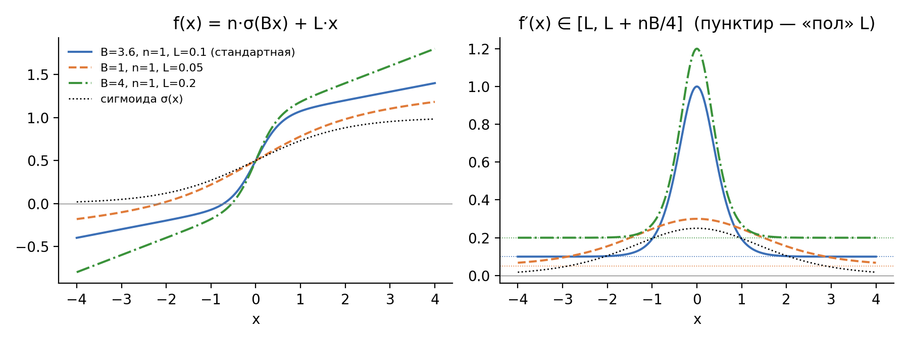
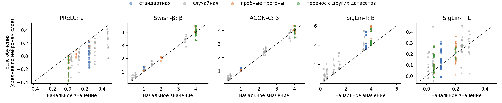
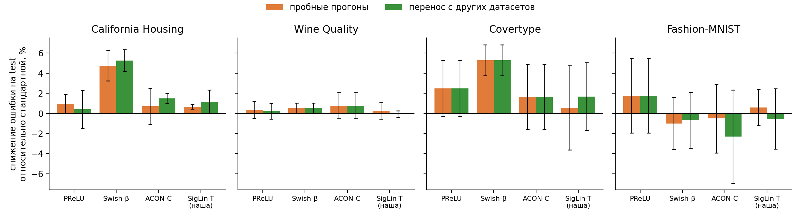
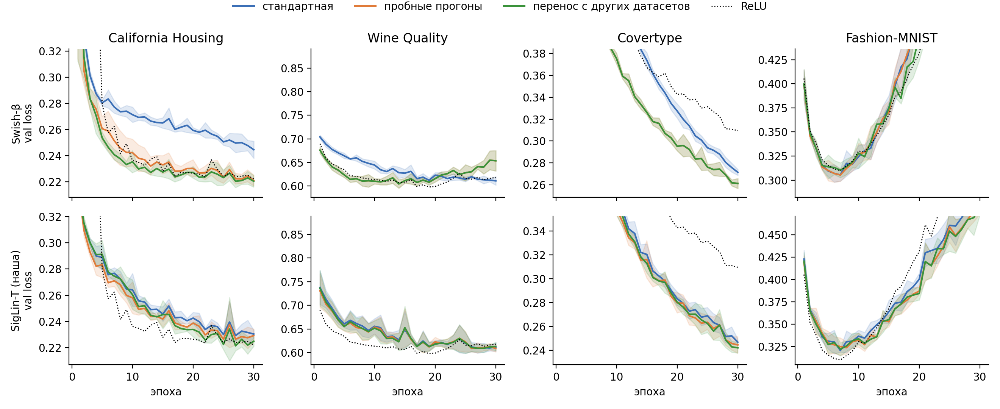
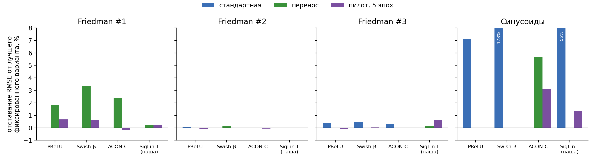
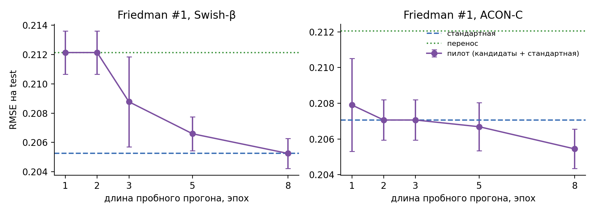
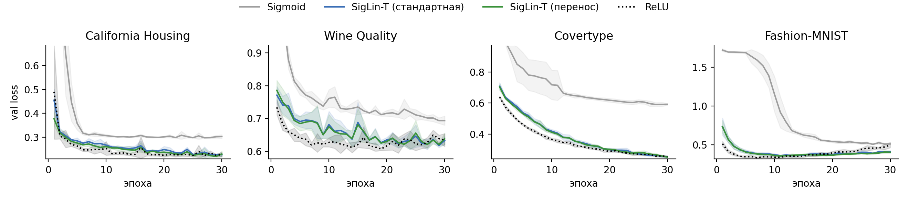
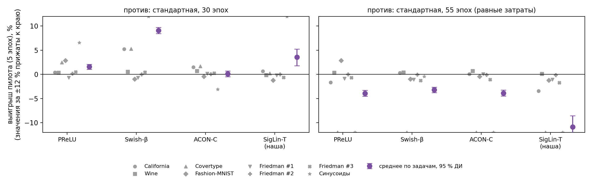

УДК 004.89

# Начальные значения параметров обучаемых функций активации: чувствительность обучения, пробные прогоны и перенос значений

**К. М. Черников**¹ (школьник)
Научный руководитель — старший преподаватель **Д. В. Сухаренко**¹ ²

¹ Самарский региональный центр для одарённых детей
² ФГБОУ ВО «Самарский государственный социально-педагогический университет»
e-mail: kirill242006@yandex.ru, sukharenko@srcod.ru

---

## Аннотация

**Актуальность.** Обучаемые функции активации (PReLU, Swish-β, ACON и др.) имеют собственные параметры, начальные значения которых обычно задаются вручную и одинаково для всех задач. При ограниченном бюджете обучения эти параметры могут не успеть далеко отойти от начальных значений, и тогда выбор начальных значений влияет на итоговое качество модели.

**Цель.** Оценить чувствительность обучения к начальным значениям параметров обучаемых функций активации и сравнить два способа их выбора: короткие пробные прогоны на целевой задаче и перенос значений, найденных на других задачах.

**Методы.** Рассмотрены четыре обучаемые функции: PReLU, Swish-β, ACON-C и предложенная сигмоида с обучаемыми крутизной, амплитудой и линейным членом (SigLin-T). Использованы многослойные перцептроны с 3 и 8 скрытыми слоями, четыре открытых набора данных (California Housing, Wine Quality, Covertype, Fashion-MNIST) и четыре синтетические гладкие задачи регрессии. Всего выполнено 1805 обучений. Значимость оценивается попарным знаковым тестом с поправкой Холма.

**Результаты.** Параметры крутизны за 30 эпох изменяются в медиане лишь на 1–11 %, а случайный выбор начальных значений многократно увеличивает разброс результатов. Пробные прогоны значимо улучшают результат относительно стандартной инициализации для PReLU и Swish-β (16 из 20 пар, $p_{\text{Holm}} = 0{,}047$). Перенос найденных значений ($a = 0{,}01$, $\beta = 4$) на другие наборы данных при той же архитектуре даёт сопоставимый эффект без дополнительных затрат. Однако оптимальное значение зависит от задачи. На гладких задачах стандартная инициализация отстаёт от лучшего фиксированного варианта до 178 %, перенос — до 5,7 %, а пробный прогон длиной 5 эпох — не более чем на 3,1 %. Прогон длиной 2 эпохи систематически выбирает значения, которые быстро снижают ошибку на начальном этапе обучения. В сводном сравнении по всем 8 задачам пробный прогон длиной 5 эпох при одинаковом числе эпох обучения не уступает стандартной инициализации и значимо превосходит её для PReLU и Swish-β (42/54 и 35/48 пар, медианный выигрыш около 0,5 %). Если же затраты на пробный прогон направить на удлинение обучения со стандартной инициализацией, последняя оказывается лучше, особенно на задачах, далёких от сходимости. В сети с 8 слоями SigLin-T превосходит обычную сигмоиду во всех 20 парах ($p < 0{,}001$).

**Выводы.** Выбор начальных значений по пробным прогонам при фиксированном бюджете обучения не хуже принятой нормы, но его затраты оправданы, когда найденные значения используются многократно. Для похожих задач и неизменной архитектуры достаточно однажды найденных значений. При смене класса задач или архитектуры их следует выбирать заново, причём пробный прогон должен быть достаточно длинным.

**Ключевые слова:** обучаемые функции активации, инициализация параметров, подбор гиперпараметров, укороченные запуски, PReLU, Swish, ACON, затухание градиента, многослойный перцептрон.

---

## 1. Введение

Функция активации определяет нелинейность нейронной сети и существенно влияет на скорость сходимости и качество обучения [1, 2]. Наряду с фиксированными функциями (ReLU, GELU) широко используются **обучаемые функции активации**: их параметры $\varphi$ настраиваются градиентным спуском совместно с весами сети $\theta$. Примеры — PReLU [3], Swish-β [4], ACON [5], рациональные функции PAU [6]. Обзоры насчитывают сотни таких функций [2, 7].

Начальные значения $\varphi_0$ обычно фиксируются эвристически и не зависят от задачи (например, $a = 0{,}25$ у PReLU и $\beta = 1$ у Swish). Влияние инициализации обучаемых активаций на сходимость отмечалось ранее [8, 9], однако систематического сравнения способов выбора $\varphi_0$ в условиях ограниченного бюджета обучения нам не известно. Если параметры $\varphi$ за время обучения изменяются слабо, итоговая форма функции активации фактически задаётся инициализацией, и выбор $\varphi_0$ становится самостоятельной задачей.

Работа продолжает предыдущее исследование автора, в котором предлагалось выбирать функцию активации по поведению ошибки на первых эпохах обучения. Здесь эта идея сформулирована в проверяемом виде — как выбор $\varphi_0$ по результатам коротких пробных прогонов — и сопоставлена с альтернативой без дополнительных затрат: переносом значений, найденных на других задачах.

**Исследовательские вопросы:**

- **ВИ1.** Насколько качество обучения при фиксированном бюджете чувствительно к начальным значениям параметров обучаемых функций активации?
- **ВИ2.** Улучшает ли выбор $\varphi_0$ по коротким пробным прогонам результат по сравнению со стандартной и случайной инициализацией?
- **ВИ3.** Достаточно ли перенести значения $\varphi_0$, найденные на других наборах данных, или пробный прогон нужен на каждой задаче?
- **ВИ4.** В каких условиях перенос перестаёт работать (иной класс задач, иная архитектура), и как результат пробного прогона зависит от его длины?
- **ВИ5.** Не уступает ли выбор начальных значений по пробным прогонам принятой норме (стандартной инициализации) в среднем по всем задачам — при одинаковом числе эпох обучения и при равных вычислительных затратах?

**Вклад работы:**

1. Предложена функция SigLin-T — сигмоида с обучаемыми крутизной, амплитудой и линейным членом, производная которой ограничена снизу; обоснован выбор её стандартной инициализации.
2. Показано, что при ограниченном бюджете параметры крутизны обучаемых активаций изменяются слабо, а качество существенно зависит от $\varphi_0$.
3. Проведено сравнение стандартной, случайной инициализации, пробных прогонов и переноса на 8 задачах и 2 архитектурах с попарным статистическим анализом.
4. Выявлена систематическая ошибка коротких пробных прогонов (предпочтение значений, быстро снижающих ошибку на начальном этапе) и показано, как она уменьшается с ростом длины прогона.
5. Проведено сводное сравнение пробных прогонов с принятой нормой по всем задачам, включая сравнение при равных вычислительных затратах, и определены условия, при которых их применение оправдано.

---

## 2. Связанные работы

**Обучаемые функции активации.**
- PReLU [3] обобщает Leaky ReLU обучаемым наклоном отрицательной части.
- Swish-β [4] получен автоматическим поиском и содержит обучаемую крутизну.
- ACON-C [5] представляет семейство гладких аппроксимаций функции максимума с обучаемыми границами производной.
- Рациональные функции PAU [6] аппроксимируют произвольную форму активации.

Систематизация обучаемых активаций приведена в [2, 7].

**Инициализация параметров активаций.** В работе [8] показано, что масштабирующий параметр адаптивных активаций ускоряет сходимость на ранних эпохах. В [9] параметры улучшенной логистической сигмоиды предустанавливаются по данным. Однако сопоставления способов выбора $\varphi_0$, в частности переноса между задачами, в этих работах нет.

**Подбор гиперпараметров по укороченным запускам.** Оценка конфигураций по частично обученным моделям лежит в основе Hyperband [17] и экстраполяции кривых обучения [18]. Известно, что ранние оценки могут смещённо отражать итоговое качество. Предлагаемая процедура является частным случаем такого подхода, применённым к $\varphi_0$.

**Затухание градиента сигмоиды.** Для его устранения предлагались добавка константы к производной сигмоиды при обратном распространении [11] и функция SigLin $\sigma(x) + a x$ с фиксированным $a$ [10]. SigLin-T обобщает последнюю, делая обучаемыми все три параметра.

---

## 3. Постановка задачи

Пусть $f(x;\,\theta,\varphi)$ — нейронная сеть с весами $\theta$ и параметрами функций активации $\varphi$. Обозначим через $\mathcal{A}(\varphi_0, s, T)$ процедуру обучения из начального состояния $(\theta_0(s), \varphi_0)$ в течение $T$ эпох. Здесь $s$ — начальное заполнение генератора случайных чисел (seed), определяющее $\theta_0$ и порядок мини-пакетов. Качество итоговой модели на тестовой выборке обозначим $Q(\varphi_0, s, T)$, ошибку на валидационной выборке после $\tau$ эпох — $\mathcal{L}_{\text{val}}(\varphi_0, s, \tau)$.

Задача состоит в выборе $\varphi_0$ при фиксированном бюджете $T$ (в работе $T = 30$ эпох). Рассматриваются следующие **стратегии выбора**:

- **Стандартная** — $\varphi_0 = \varphi^{\text{def}}$ из оригинальной работы.
- **Случайная** — $\varphi_0 \sim U(\Phi)$, где $\Phi$ — область, охватывающая кандидатов.
- **Пробные прогоны** (пилот) с множеством кандидатов $C = \{c_1, \dots, c_K\}$ и длиной $\tau$:
$$\hat\varphi_0 = \arg\min_{c \in C} \; \mathcal{L}_{\text{val}}(c, s, \tau),$$
после чего выполняется полное обучение $\mathcal{A}(\hat\varphi_0, s, T)$. Дополнительные затраты составляют $K\tau$ эпох.
- **Перенос** — без вычислений на целевой задаче $d$ берётся кандидат, наиболее часто выбиравшийся пилотом на остальных наборах данных $D \setminus \{d\}$ (схема «оставить один набор данных»).
- **Стандартная с равными затратами** — $\varphi_0 = \varphi^{\text{def}}$, бюджет $T + K\tau$ эпох. Это база для сравнения с пилотом при одинаковом суммарном объёме вычислений.

Сравнение стратегий проводится **попарно при одинаковом $s$**: обе модели стартуют с одинаковых весов $\theta_0(s)$, и различие обусловлено только $\varphi_0$.

---

## 4. Функции активации

Все параметры обучаются отдельно для каждого нейрона. Здесь $\sigma(x) = 1/(1 + e^{-x})$ — логистическая сигмоида.

*Таблица 1. Функции активации, стандартные начальные значения и множества кандидатов*

| Функция | Формула $f(x)$ | $\varphi^{\text{def}}$ | Кандидаты $C$ |
|---|---|---|---|
| PReLU [3] | $x$ при $x \ge 0$; $a x$ при $x < 0$ | $a = 0{,}25$ | $a \in \{0{,}01;\ 0{,}1;\ 0{,}25;\ 0{,}5\}$ |
| Swish-β [4] | $x\,\sigma(\beta x)$ | $\beta = 1$ | $\beta \in \{0{,}5;\ 1;\ 2;\ 4\}$ |
| ACON-C [5] | $(p_1 - p_2)\,x\,\sigma\big(\beta(p_1 - p_2)x\big) + p_2 x$ | $p_1, p_2 \sim \mathcal N(0,1)$, $\beta = 1$ | $(p_1, p_2, \beta) \in \{(1;0;1), (1;0{,}25;1), (1;0;4), (1;0{,}25;4)\}$ |
| SigLin-T | $n\,\sigma(Bx) + L x$ | $B = 3{,}6$, $n = 1$, $L = 0{,}1$ | $(B, n, L) \in \{(1;1;0{,}05), (1;1;0{,}2), (4;1;0{,}05), (4;1;0{,}2)\}$ |

Стандартные значения PReLU, Swish-β и ACON-C соответствуют оригинальным работам и их программной реализации.

### 4.1. Функция SigLin-T

$$f(x) = n\,\sigma(Bx) + L\,x, \qquad f'(x) = nB\,\sigma(Bx)\big(1 - \sigma(Bx)\big) + L.$$

Поскольку $\sigma(z)(1 - \sigma(z)) \in (0;\ 1/4]$, производная ограничена:

$$L \;\le\; f'(x) \;\le\; L + \frac{nB}{4}.$$

При $L > 0$ производная нигде не обращается в нуль, и градиент не затухает при насыщении сигмоидной части. В этом её принципиальное отличие от сигмоиды, для которой $f'(x) \to 0$ при $|x| \to \infty$.

**Стандартная инициализация** выбрана до проведения экспериментов из условия единичного наклона в нуле, характерного для распространённых функций активации:

$$f'(0) = \frac{nB}{4} + L = 1, \quad L = 0{,}1,\ n = 1 \;\Rightarrow\; B = 3{,}6.$$

**Новизна.** Аналогичные идеи — постоянная добавка к производной [11] и обучаемые границы производной в ACON-C [5] — известны. Насколько нам известно, новыми в SigLin-T являются обучаемость всех трёх параметров и их инициализация по пробным прогонам.

*Рис. 1. Функция SigLin-T (слева) и её производная (справа) при различных параметрах; пунктир — нижняя граница производной $L$.*

---

## 5. Методика эксперимента

### 5.1. Данные

*Таблица 2. Наборы данных*

| Набор данных | Задача | Объектов (обуч. / вал. / тест) | Признаков | Метрика |
|---|---|---|---|---|
| California Housing [12] | регрессия | 14 448 / 3 096 / 3 096 | 8 | RMSE |
| Wine Quality [13] | регрессия | 4 547 / 975 / 975 | 12 | RMSE |
| Covertype [14] | 7 классов | 140 000 / 30 000 / 30 000¹ | 54 | доля верных ответов |
| Fashion-MNIST [15] | 10 классов | 50 000 / 10 000 / 10 000 | 784 | доля верных ответов |
| Friedman #1 [19]² | регрессия | 14 000 / 3 000 / 3 000 | 10 | RMSE |
| Friedman #2 [19, 20]² | регрессия | 14 000 / 3 000 / 3 000 | 4 | RMSE |
| Friedman #3 [19, 20]² | регрессия | 14 000 / 3 000 / 3 000 | 4 | RMSE |
| Синусоиды² | регрессия | 14 000 / 3 000 / 3 000 | 8 | RMSE |

¹ Стратифицированная подвыборка 200 000 из 581 012 объектов.
² Синтетические задачи с гладкой целевой функцией; используются только для проверки переноса (раздел 6.4).

Целевые функции синтетических задач:

$$\text{Friedman \#1:}\quad y = 10\sin(\pi x_1 x_2) + 20(x_3 - 0{,}5)^2 + 10x_4 + 5x_5 + \varepsilon,\quad \varepsilon \sim \mathcal N(0, 1),$$

где признаки $x_6, \dots, x_{10}$ не влияют на ответ. Для Friedman #2 и #3 шум задан как в [20] ($\sigma_\varepsilon = 125$ и $0{,}1$).

$$\text{Синусоиды:}\quad y = \sin(2\pi x_1)\cos(\pi x_2) + \sin(3 x_3 x_4) + 0{,}5\,x_5^2 + \varepsilon,\quad x \in [-1;1]^8,\ \varepsilon \sim \mathcal N(0;\,0{,}1^2).$$

Разбиение на обучающую, валидационную и тестовую выборки (70/15/15) фиксировано. Для Fashion-MNIST используется официальная тестовая выборка. Признаки, а для регрессии и целевая переменная, стандартизуются по обучающей выборке, поэтому RMSE выражен в единицах стандартного отклонения цели.

### 5.2. Модели и обучение

- **Архитектуры:** многослойный перцептрон с 3 скрытыми слоями по 128 нейронов (основная) и с 8 скрытыми слоями по 128 нейронов (проверка переноса между архитектурами).
- **Оптимизатор:** Adam [16], скорость обучения $10^{-3}$ для весов и параметров активаций.
- **Бюджет:** $T = 30$ эпох.
- **Размер мини-пакета:** 256 (64 для Wine Quality, 512 для Covertype).
- **Функции потерь:** MSE (регрессия), перекрёстная энтропия (классификация).
- **Итоговая метрика:** тестовая метрика в эпоху с наименьшей ошибкой на валидации (ранняя остановка по валидации).
- **Число повторов:** 5 seed для основных наборов данных и глубокой сети, 10 seed для синтетических задач.
- **Справочные функции:** ReLU и GELU, для глубокой сети — также сигмоида.
- **База с равными затратами:** стандартная инициализация, 55 эпох. Это соответствует затратам пилота длиной 5 эпох с пятью кандидатами (30 + 25); для Swish-β, у которого кандидатов четыре, база получает даже на 5 эпох больше.

### 5.3. Метрики

**Эпоха достижения цели** (скорость обучения):
$$e^{*} = \min\{\, e : \mathcal L_{\text{val}}(e) \le 1{,}05 \cdot \operatorname{med}_{\text{runs}} \min_{e'} \mathcal L_{\text{val}}(e') \,\}.$$
Здесь медиана берётся по всем обучениям на данном наборе данных; если цель не достигнута, полагается $e^* = 31$.

**Относительное изменение параметра** активации за время обучения:
$$\Delta\varphi = \frac{\varphi_T - \varphi_0}{|\varphi_0|}.$$

**Отставание от лучшего фиксированного варианта** (для синтетических задач). Для стратегии $S$, функции $g$ и задачи $d$:
$$r_S(d, g) = \frac{\overline{\text{RMSE}}_S - \min\big(\overline{\text{RMSE}}_{\text{def}},\, \overline{\text{RMSE}}_{\text{tr}}\big)}{\min\big(\overline{\text{RMSE}}_{\text{def}},\, \overline{\text{RMSE}}_{\text{tr}}\big)} \cdot 100\,\%,$$
где черта обозначает среднее по seed. Величина $\max_d r_S$ характеризует худший случай стратегии.

**Средний выигрыш относительно нормы** (раздел 6.6). Для пары (задача $d$, seed $s$):
$$\delta_{d,s} = \frac{\mathrm{err}_{\text{ref}} - \mathrm{err}_{\text{pilot}}}{\mathrm{err}_{\text{ref}}},$$
где $\mathrm{err}$ — RMSE или $1 - $ доля верных ответов. Положительное значение означает, что пилот лучше. Эффект задачи — среднее $\bar\delta_d$ по seed; эффект функции — среднее $\bar\delta$ по задачам, где каждая задача имеет одинаковый вес. 95 %-й доверительный интервал строится бутстрепом: 5000 повторений, seed переизвлекаются внутри каждой задачи. Поскольку среднее чувствительно к отдельным задачам с большим эффектом, дополнительно приводится медиана $\bar\delta_d$ по задачам.

### 5.4. Статистический анализ

Для каждой функции и стратегии подсчитывается число пар (набор данных × seed), в которых стратегия даёт меньшую тестовую ошибку, чем стандартная инициализация. Значимость оценивается **точным двусторонним биномиальным (знаковым) тестом** при $H_0$: вероятность выигрыша равна 0,5.

Поскольку для каждой стратегии проверяются $m = 4$ функции, применяется **поправка Холма**:
$$p_{(i)}^{\text{adj}} = \max_{j \le i} \min\big(1,\ (m - j + 1)\,p_{(j)}\big).$$

Пары, относящиеся к разным функциям при одном seed и наборе данных, не являются независимыми, поэтому выводы формулируются для каждой функции отдельно.

### 5.5. Объём вычислений

| Серия | Обучений |
|---|---|
| Основная: 4 набора данных × 5 seed × (ReLU, GELU + 4 функции × {стандартная, случайная, пилот, перенос}) | 360 |
| Пилот со стандартной инициализацией среди кандидатов | 40 |
| Синтетические задачи (10 seed), все стратегии | 580 |
| Пилот длиной 5 эпох (синтетические задачи; California Housing и Wine Quality) | 200 |
| Зависимость от длины пилота (1, 2, 3, 8 эпох) | 80 |
| Глубокая сеть: стандартная, перенос, пилот 2 и 5 эпох, справочные функции | 265 |
| Пилот длиной 5 эпох на Covertype и Fashion-MNIST (сводное сравнение) | 40 |
| Стандартная инициализация с равными затратами (55 эпох), все 8 задач | 240 |
| **Итого** | **1805** |

Расчёты выполнены на CPU (12 ядер) с параллельным запуском.

---

## 6. Результаты

### 6.1. Чувствительность к начальным значениям (ВИ1)

При фиксированном бюджете результат заметно зависит от $\varphi_0$.

- Для Swish-β на California Housing переход от $\beta = 1$ к $\beta = 4$ снижает RMSE с 0,478 до 0,455. Это больше, чем различие между ReLU и GELU (0,452 и 0,462).
- Случайная инициализация резко увеличивает разброс результатов: для SigLin-T на California Housing стандартное отклонение RMSE по seed возрастает с 0,004 до 0,056.

**Механизм — слабое изменение параметров за время обучения (рис. 4).**
- Медианное относительное изменение параметров крутизны $\beta$ (Swish-β, ACON-C) и $B$ (SigLin-T) составляет 1–11 % на всех наборах данных; исключение — SigLin-T на Covertype (+42 %).
- Наклон PReLU, напротив, изменяется сильно и нередко становится отрицательным.

Таким образом, при ограниченном бюджете итоговая крутизна функции в значительной мере определяется начальным значением.

*Рис. 4. Начальные и итоговые значения параметров функций активации (среднее по нейронам слоя; точка — слой одной сети); пунктир — $\varphi_T = \varphi_0$.*

### 6.2. Пробные прогоны и стандартная инициализация (ВИ2)

*Таблица 3. Качество на тестовой выборке, сеть 3 × 128 (среднее ± ст. откл. по 5 seed): RMSE для регрессии (меньше — лучше), доля верных ответов для классификации (больше — лучше)*

| Функция | Инициализация | California Housing | Wine Quality | Covertype | Fashion-MNIST |
|---|---|---|---|---|---|
| ReLU | — | 0,4521 ± 0,0024 | 0,8038 ± 0,0094 | 0,8768 ± 0,0033 | 0,8813 ± 0,0028 |
| GELU | — | 0,4624 ± 0,0028 | 0,8101 ± 0,0039 | 0,8987 ± 0,0010 | 0,8827 ± 0,0030 |
| PReLU | стандартная | 0,4537 ± 0,0042 | 0,8049 ± 0,0061 | 0,8834 ± 0,0025 | 0,8805 ± 0,0025 |
| PReLU | пилот | 0,4494 ± 0,0043 | 0,8020 ± 0,0040 | 0,8863 ± 0,0018 | 0,8827 ± 0,0031 |
| PReLU | перенос | 0,4518 ± 0,0054 | 0,8031 ± 0,0054 | 0,8863 ± 0,0018 | 0,8827 ± 0,0031 |
| Swish-β | стандартная | 0,4782 ± 0,0076 | 0,8118 ± 0,0017 | 0,8914 ± 0,0015 | 0,8828 ± 0,0036 |
| Swish-β | пилот | 0,4554 ± 0,0044 | 0,8075 ± 0,0041 | 0,8971 ± 0,0022 | 0,8817 ± 0,0025 |
| Swish-β | перенос | 0,4530 ± 0,0047 | 0,8075 ± 0,0041 | 0,8971 ± 0,0022 | 0,8821 ± 0,0020 |
| ACON-C | стандартная | 0,4575 ± 0,0008 | 0,8141 ± 0,0070 | 0,8997 ± 0,0018 | 0,8828 ± 0,0038 |
| ACON-C | пилот | 0,4542 ± 0,0081 | 0,8078 ± 0,0049 | 0,9014 ± 0,0022 | 0,8823 ± 0,0026 |
| ACON-C | перенос | 0,4506 ± 0,0019 | 0,8078 ± 0,0049 | 0,9014 ± 0,0022 | 0,8802 ± 0,0041 |
| SigLin-T | стандартная | 0,4627 ± 0,0039 | 0,8041 ± 0,0049 | 0,9042 ± 0,0021 | 0,8743 ± 0,0021 |
| SigLin-T | пилот | 0,4597 ± 0,0047 | 0,8021 ± 0,0044 | 0,9048 ± 0,0024 | 0,8750 ± 0,0025 |
| SigLin-T | перенос | 0,4573 ± 0,0065 | 0,8046 ± 0,0039 | 0,9058 ± 0,0025 | 0,8736 ± 0,0020 |

*Таблица 4. Число пар (из 20), в которых стратегия лучше стандартной инициализации; p-value знакового теста с поправкой Холма*

| Функция | Случайная | Пилот (2 эпохи) | Перенос |
|---|---|---|---|
| PReLU | 11/20 ($p = 1{,}000$) | **16/20 ($p = 0{,}047$)** | **16/20 ($p = 0{,}035$)** |
| Swish-β | 11/20 ($p = 1{,}000$) | **16/20 ($p = 0{,}047$)** | **19/20 ($p < 0{,}001$)** |
| ACON-C | 5/20 ($p = 0{,}124$) | 10/20 ($p = 1{,}000$) | 11/20 ($p = 1{,}000$) |
| SigLin-T | 2/20 ($p = 0{,}002$) | 15/20 ($p = 0{,}083$) | 12/20 ($p = 1{,}000$) |

*Рис. 2. Относительное снижение тестовой ошибки по сравнению со стандартной инициализацией (для классификации ошибка равна 1 − доля верных ответов); среднее ± ст. откл. по 5 seed.*

**Эффект пилота различается по функциям.**
- Пилот (2 эпохи) **значимо улучшает** результат для PReLU и Swish-β (по 16 из 20 пар).
- Для SigLin-T выигрыш наблюдается в 15 из 20 пар, но после поправки на множественность не значим.
- Для ACON-C эффект отсутствует.

Наибольший эффект — у Swish-β: RMSE на California Housing снижается с 0,478 до 0,455, доля верных ответов на Covertype растёт с 0,891 до 0,897. На Fashion-MNIST минимум валидационной ошибки достигается в среднем к 7-й эпохе, после чего наблюдается переобучение (рис. 3), поэтому влияние $\varphi_0$ мало.

**Случайная инициализация** не превосходит стандартную ни для одной функции, а для SigLin-T значимо хуже (2 из 20). Следовательно, эффект пилота обусловлен именно **отбором** кандидатов, а не отклонением от стандартного значения как таковым.

**Дополнительная проверка.** Добавление стандартной инициализации в множество кандидатов ACON-C и SigLin-T ($K = 5$) не изменило выводов. Стандартный вариант был выбран в 7 из 20 и 2 из 20 случаев соответственно; выигрыш относительно стандартной инициализации — 7/20 и 13/20 пар, оба незначимы. Следовательно, отсутствие эффекта для ACON-C объясняется не составом кандидатов, а тем, что двухэпохальный прогон плохо предсказывает итог обучения этой функции.

### 6.3. Перенос значений (ВИ3)

Пилот на основных наборах данных почти всегда выбирал одни и те же кандидаты:
- PReLU: $a = 0{,}01$;
- Swish-β: $\beta = 4$;
- ACON-C: $(p_1, p_2, \beta) = (1; 0; 4)$;
- SigLin-T: $B = 4$.

Исключение — Fashion-MNIST, где для Swish-β и ACON-C чаще выбиралось $\beta = 1$.

**Перенос без пилота на целевой задаче сохраняет эффект.** Перенос значимо улучшает результат для PReLU (16/20) и Swish-β (19/20). Для SigLin-T эффект меньше (12/20), поскольку её стандартное значение $B = 3{,}6$ близко к переносимому $B = 4$.

**Интерпретация.**
- Значение $a = 0{,}01$ совпадает со стандартным наклоном Leaky ReLU.
- При $\beta = 4$ функция $x\,\sigma(\beta x)$ близка к ReLU.

Таким образом, на рассмотренных данных отбор смещает обучаемые функции к форме «выпрямителя».

**Сравнение с ReLU.** Улучшенная инициализация приближает обучаемые функции к уровню ReLU, но систематического превосходства над ней не даёт. Выигрыши у ReLU в попарном сравнении: PReLU — 14/20, Swish-β — 12/20, ACON-C — 13/20, SigLin-T — 7/20; все различия незначимы. Результат зависит от данных: на Covertype все обучаемые функции лучше ReLU во всех 5 seed, на California Housing и Wine Quality — чаще хуже.

**Скорость обучения.** С учётом $K\tau = 8$ дополнительных эпох пилот окупается лишь в отдельных случаях. Перенос лишён этих затрат и сокращает $e^*$ на регрессионных задачах:
- California Housing: Swish-β — с 31 (цель не достигнута) до 10; ACON-C — с 21 до 9,4; PReLU — с 17,6 до 11,6;
- Wine Quality: Swish-β — с 12,8 до 5,0.

На Covertype и Fashion-MNIST ускорение невелико — 0–4 эпохи (рис. 3).

*Рис. 3. Валидационная ошибка по эпохам для Swish-β (сверху) и SigLin-T (снизу); линия — среднее, заливка — ст. откл. по 5 seed, пунктир — ReLU.*

### 6.4. Границы применимости переноса (ВИ4)

#### 6.4.1. Задачи иного класса

На четырёх синтетических гладких задачах (10 seed) сравнивались стандартная инициализация, перенос и пилоты длиной 2 и 5 эпох. В пилоте длиной 5 эпох стандартное значение включено в число кандидатов; его затраты составляют 20–25 эпох.

*Таблица 5. RMSE на тестовой выборке для гладких задач регрессии (среднее ± ст. откл. по 10 seed)*

| Функция | Инициализация | Friedman #1 | Friedman #2 | Friedman #3 | Синусоиды |
|---|---|---|---|---|---|
| ReLU | — | 0,2169 ± 0,0018 | 0,3175 ± 0,0006 | 0,3179 ± 0,0021 | 0,2153 ± 0,0088 |
| GELU | — | 0,2059 ± 0,0010 | 0,3164 ± 0,0005 | 0,3164 ± 0,0034 | 0,3060 ± 0,0554 |
| PReLU | стандартная | 0,2127 ± 0,0011 | 0,3175 ± 0,0006 | 0,3191 ± 0,0018 | 0,2163 ± 0,0067 |
| PReLU | перенос | 0,2165 ± 0,0019 | 0,3174 ± 0,0008 | 0,3178 ± 0,0025 | 0,2019 ± 0,0065 |
| PReLU | пилот, 2 эпохи | 0,2150 ± 0,0018 | 0,3172 ± 0,0007 | 0,3182 ± 0,0027 | 0,2030 ± 0,0066 |
| PReLU | пилот, 5 эпох | 0,2141 ± 0,0016 | 0,3170 ± 0,0005 | 0,3175 ± 0,0013 | 0,2019 ± 0,0065 |
| Swish-β | стандартная | 0,2053 ± 0,0010 | 0,3162 ± 0,0004 | 0,3177 ± 0,0020 | 0,5038 ± 0,0877 |
| Swish-β | перенос | 0,2121 ± 0,0015 | 0,3167 ± 0,0003 | 0,3162 ± 0,0027 | 0,1814 ± 0,0064 |
| Swish-β | пилот, 2 эпохи | 0,2121 ± 0,0015 | 0,3164 ± 0,0003 | 0,3162 ± 0,0027 | 0,1814 ± 0,0064 |
| Swish-β | пилот, 5 эпох | 0,2066 ± 0,0011 | 0,3162 ± 0,0004 | 0,3163 ± 0,0027 | 0,1814 ± 0,0064 |
| ACON-C | стандартная | 0,2071 ± 0,0011 | 0,3166 ± 0,0006 | 0,3166 ± 0,0026 | 0,1608 ± 0,0037 |
| ACON-C | перенос | 0,2121 ± 0,0016 | 0,3166 ± 0,0004 | 0,3157 ± 0,0027 | 0,1699 ± 0,0054 |
| ACON-C | пилот, 2 эпохи | 0,2121 ± 0,0016 | 0,3163 ± 0,0004 | 0,3157 ± 0,0027 | 0,1699 ± 0,0054 |
| ACON-C | пилот, 5 эпох | 0,2067 ± 0,0013 | 0,3164 ± 0,0004 | 0,3158 ± 0,0030 | 0,1657 ± 0,0077 |
| SigLin-T | стандартная | 0,2094 ± 0,0012 | 0,3173 ± 0,0005 | 0,3149 ± 0,0022 | 0,4063 ± 0,1266 |
| SigLin-T | перенос | 0,2099 ± 0,0015 | 0,3173 ± 0,0006 | 0,3153 ± 0,0012 | 0,2628 ± 0,0696 |
| SigLin-T | пилот, 2 эпохи | 0,2102 ± 0,0010 | 0,3172 ± 0,0005 | 0,3171 ± 0,0020 | 0,2635 ± 0,0756 |
| SigLin-T | пилот, 5 эпох | 0,2098 ± 0,0008 | 0,3173 ± 0,0005 | 0,3169 ± 0,0025 | 0,2663 ± 0,0759 |

**Оптимальное значение зависит от задачи.**
- Swish-β на Friedman #1: лучше стандартное $\beta = 1$, перенесённое $\beta = 4$ проигрывает ему во всех 10 seed.
- Swish-β на синусоидах, наоборот: $\beta = 1$ приводит к неудовлетворительному обучению (RMSE 0,504 против 0,181 при $\beta = 4$).
- Аналогично для SigLin-T на синусоидах: 0,406 при стандартной инициализации против 0,263 при переносе.
- Для ACON-C на синусоидах лучшей оказывается стандартная инициализация.
- На Friedman #2 различия не превышают 0,2 %.

Следовательно, **ни стандартное, ни перенесённое значение не оптимально для всех задач**.

**Короткий и длинный пилот ведут себя по-разному.**
- Пилот длиной 2 эпохи выбирает те же значения, что и перенос, и проигрывает вместе с ним.
- Пилот длиной 5 эпох адаптируется к задаче: на Friedman #1 выбирает $\beta = 1$–$2$, на синусоидах — $\beta = 4$ (10 из 10 seed).
- На Friedman #1 пилот длиной 5 эпох превосходит перенос во всех 10 парах для Swish-β и во всех 10 для ACON-C ($p \approx 0{,}002$ для каждой функции).

*Таблица 6. Наибольшее отставание от лучшего фиксированного варианта $\max_d r_S(d, g)$ по четырём гладким задачам, %*

| Функция | Стандартная | Перенос | Пилот, 5 эпох |
|---|---|---|---|
| PReLU | 7,1 | 1,8 | **0,7** |
| Swish-β | 177,8 | 3,4 | **0,7** |
| ACON-C | **0,3** | 5,7 | 3,1 |
| SigLin-T | 54,6 | **0,2** | 1,3 |

Каждое фиксированное значение на какой-либо задаче существенно проигрывает. Пилот длиной 5 эпох ни для одной функции и задачи не отстаёт более чем на 3,1 % (рис. 5), то есть является наиболее **устойчивой** стратегией в худшем случае. На основных наборах данных он выбирает те же значения, что и перенос, и не уступает стандартной инициализации: выигрыш на California Housing и Wine Quality — PReLU 8/10, Swish-β 10/10, ACON-C 7/10, SigLin-T 8/10.

*Рис. 5. Отставание RMSE от лучшего из двух фиксированных вариантов (стандартная инициализация или перенос) на гладких задачах; столбцы, выходящие за шкалу, подписаны.*

#### 6.4.2. Длина пробного прогона

Зависимость от длины пилота $\tau$ на Friedman #1 представлена на рис. 6.

- **Swish-β:**
  - при $\tau = 1$–$2$ всегда выбирается $\beta = 4$, ошибка совпадает с переносом (0,2121);
  - при $\tau = 3$ выбор неустойчив;
  - при $\tau = 5$ смещается к $\beta = 1$–$2$;
  - при $\tau = 8$ во всех 10 seed выбирается $\beta = 1$, и ошибка совпадает со стандартной (0,2053).
- **ACON-C:** при $\tau = 8$ ошибка 0,2055 — ниже, чем при стандартной инициализации (0,2071).

Затраты пилота линейны по $\tau$: при пяти кандидатах прогон длиной 8 эпох требует 40 эпох, что превышает сам бюджет обучения. Таким образом, $\tau$ задаёт компромисс между точностью выбора и стоимостью.

*Рис. 6. RMSE на Friedman #1 в зависимости от длины пробного прогона $\tau$ (среднее ± ст. откл. по 10 seed); горизонтальные линии — стандартная инициализация и перенос.*

#### 6.4.3. Иная архитектура

Значения, найденные на сети 3 × 128, без нового пилота применены к сети 8 × 128 (табл. 7).

*Таблица 7. Качество на тестовой выборке для сети 8 × 128 (среднее ± ст. откл. по 5 seed; метрики как в табл. 3)*

| Функция | Инициализация | California Housing | Wine Quality | Covertype | Fashion-MNIST |
|---|---|---|---|---|---|
| ReLU | — | 0,4509 ± 0,0027 | 0,8104 ± 0,0049 | 0,9024 ± 0,0034 | 0,8781 ± 0,0057 |
| Сигмоида | — | 0,5284 ± 0,0016 | 0,8418 ± 0,0037 | 0,7679 ± 0,0061 | 0,8366 ± 0,0070 |
| PReLU | стандартная | 0,4486 ± 0,0048 | 0,8008 ± 0,0077 | 0,9098 ± 0,0020 | 0,8773 ± 0,0039 |
| PReLU | перенос | 0,4518 ± 0,0027 | 0,8053 ± 0,0090 | 0,9060 ± 0,0016 | 0,8785 ± 0,0039 |
| Swish-β | стандартная | 0,4781 ± 0,0039 | 0,8080 ± 0,0053 | 0,8914 ± 0,0012 | 0,8793 ± 0,0048 |
| Swish-β | перенос | 0,4543 ± 0,0033 | 0,8121 ± 0,0061 | 0,9153 ± 0,0009 | 0,8773 ± 0,0032 |
| SigLin-T | стандартная | 0,4599 ± 0,0055 | 0,8025 ± 0,0033 | 0,9033 ± 0,0029 | 0,8708 ± 0,0017 |
| SigLin-T | перенос | 0,4536 ± 0,0051 | 0,8030 ± 0,0053 | 0,9031 ± 0,0029 | 0,8711 ± 0,0025 |

**Swish-β.** Значение $\beta = 4$ сохраняет пользу: 14 из 20 пар, во всех 5 seed на California Housing и Covertype. На Covertype получен лучший результат работы — 0,915. Однако после поправки различие незначимо ($p = 0{,}346$).

**PReLU.** Перенесённое $a = 0{,}01$ уступает стандартному $a = 0{,}25$ (7 из 20 пар). Пилоты на самой глубокой сети этого не исправляют: в 11 из 20 случаев выбирается $a = 0{,}01$, а выигрыш у стандартной инициализации составляет 6/20 при $\tau = 2$ и 3/10 при $\tau = 5$. По-видимому, преимущество $a = 0{,}25$ в глубокой сети проявляется лишь на поздних эпохах и не обнаруживается коротким прогоном.

**SigLin-T.** Перенос без эффекта (11/20).

Следовательно, перенос между наборами данных при неизменной архитектуре надёжен, а при смене архитектуры — нет.

### 6.5. Роль линейного члена SigLin-T

В сети 8 × 128 обычная сигмоида обучается неудовлетворительно: ни на одном наборе данных она не достигает целевой ошибки за 30 эпох, а на Covertype её доля верных ответов составляет 0,768 против 0,903 у SigLin-T (рис. 7).

- SigLin-T превосходит сигмоиду во **всех 20 парах** ($p < 0{,}001$).
- По качеству SigLin-T сопоставима с ReLU: значимых различий нет.
- Обучаемый параметр $L$ сохраняется около 0,1.

Результат подтверждает, что ненулевая нижняя граница производной устраняет затухание градиента, ограничивающее применимость сигмоиды в глубоких сетях.

В сети 3 × 128 SigLin-T со стандартной инициализацией — лучшая функция на Covertype: 0,904 против 0,877 у ReLU, 0,899 у GELU и 0,900 у ACON-C, с превосходством над каждой конфигурацией во всех 5 seed. На Wine Quality она находится на уровне ReLU, на Fashion-MNIST и California Housing уступает другим функциям.

*Рис. 7. Валидационная ошибка по эпохам в сети 8 × 128: сигмоида, SigLin-T и ReLU (среднее ± ст. откл. по 5 seed).*

### 6.6. Сводное сравнение с принятой нормой (ВИ5)

Пилот длиной 5 эпох (стандартное значение включено в число кандидатов) сравнивается со стандартной инициализацией на всех 8 задачах сети 3 × 128: 4 основных набора данных × 5 seed и 4 гладкие задачи × 10 seed. Рассматриваются две базы сравнения:
- стандартная инициализация при **одинаковом числе эпох обучения** (30);
- стандартная инициализация при **равных суммарных затратах** (55 эпох).

*Таблица 8. Выигрыш пилота длиной 5 эпох относительно стандартной инициализации по 8 задачам: среднее по задачам с 95 %-м бутстреп-интервалом, медиана по задачам, число задач, где пилот не хуже, число выигранных пар (без ничьих) и p-value знакового теста с поправкой Холма*

**(а) Одинаковое число эпох обучения (30)**

| Функция | Средний выигрыш, % [95 % ДИ] | Медиана, % | Задач не хуже | Пар выиграно | $p_{\text{Holm}}$ |
|---|---|---|---|---|---|
| PReLU | **+1,6** [+1,1; +2,1] | +0,45 | 7/8 | 42/54 | **< 0,001** |
| Swish-β | **+9,1** [+8,4; +9,7] | +0,49 | 6/8 | 35/48 | **0,006** |
| ACON-C | +0,1 [−0,5; +0,7] | +0,23 | 6/8 | 26/42 | 0,328 |
| SigLin-T | +3,6 [+1,8; +5,2] | −0,07 | 3/8 | 26/53 | 1,000 |

**(б) Равные затраты: стандартная инициализация обучается 55 эпох**

| Функция | Средний выигрыш, % [95 % ДИ] | Медиана, % | Задач не хуже | Пар выиграно | $p_{\text{Holm}}$ |
|---|---|---|---|---|---|
| PReLU | −3,9 [−4,5; −3,3] | −0,78 | 3/8 | 15/59 | < 0,001 |
| Swish-β | −3,2 [−3,8; −2,6] | −0,70 | 2/8 | 17/57 | 0,003 |
| ACON-C | −3,9 [−4,5; −3,2] | −0,24 | 3/8 | 14/55 | < 0,001 |
| SigLin-T | −10,9 [−13,7; −8,6] | −1,49 | 1/8 | 6/58 | < 0,001 |

**Одинаковое число эпох.** Пилот не уступает принятой норме ни для одной функции.
- Для PReLU и Swish-β он **значимо лучше** (42 из 54 и 35 из 48 пар).
- Для ACON-C и SigLin-T результаты сопоставимы.
- Наибольшее отставание на отдельной задаче не превышает 3,1 % (ACON-C на синусоидах).
- Высокие средние значения для Swish-β и SigLin-T в основном обусловлены задачей с синусоидами, где стандартная инициализация обучается плохо (выигрыш 63 % и 30 %). Поэтому устойчивой оценкой типичного эффекта служит медиана — около +0,5 % для PReLU и Swish-β.

**Равные затраты.** Если эпохи, затрачиваемые на пробный прогон, отдать обучению со стандартной инициализацией, оно оказывается значимо лучше для всех функций.
- Основной вклад дают задачи, далёкие от сходимости: на Covertype удлинённое обучение выигрывает 15–23 %, на синусоидах — до 61 %.
- На задачах, где обучение сходится за 30 эпох (Wine Quality, Fashion-MNIST, Friedman #2), различия малы, а для PReLU на Fashion-MNIST пилот по-прежнему лучше (+2,9 %).

Таким образом, при фиксированном бюджете обучения пробный прогон в среднем не хуже нормы, но затраты на него оправданы лишь тогда, когда они не конкурируют с обучением самой модели. Например, значения подбираются один раз и затем переиспользуются (перенос, раздел 6.3), или бюджет обучения итоговой модели фиксирован внешними условиями.

*Рис. 8. Выигрыш пилота длиной 5 эпох относительно стандартной инициализации при одинаковом числе эпох (слева) и при равных затратах (справа). Серые маркеры — задачи (среднее по seed), фиолетовые — среднее по задачам с 95 %-м доверительным интервалом; значения за пределами ±12 % прижаты к краю шкалы.*

---

## 7. Обсуждение

**Чувствительность как следствие ограниченного бюджета.** Слабое изменение параметров крутизны (раздел 6.1) означает, что за $T = 30$ эпох оптимизация не «забывает» начальное значение $\varphi_0$. Поэтому выбор $\varphi_0$ эквивалентен выбору формы функции активации. При неограниченном обучении влияние инициализации, вероятно, уменьшилось бы; проверка этого выходит за рамки работы.

**Смещение коротких пробных прогонов.** Короткий прогон оценивает не итоговое качество, а скорость начального снижения ошибки. Значения, сближающие функцию с выпрямителем ($\beta = 4$, $a = 0{,}01$), ускоряют начальный этап обучения, поэтому выбираются коротким прогоном и тогда, когда к концу обучения они хуже (Friedman #1, PReLU в глубокой сети). Это согласуется с известной проблемой ранних оценок в методах укороченных запусков [17, 18]. С ростом $\tau$ смещение уменьшается (рис. 6), но возрастает стоимость.

**Перенос против пилота.** Перенос — это выбор одного значения по нескольким задачам. Он эффективен, пока целевая задача похожа на исходные, и не требует затрат. Пилот адаптируется к конкретной задаче и поэтому устойчивее при смене класса задач (табл. 6), но лишь при достаточной длине. Ни одна стратегия не оказалась лучшей во всех условиях.

**Цена пробного прогона.** Сравнение при равных затратах (раздел 6.6) показывает, что в режиме, далёком от сходимости, дополнительные эпохи обучения ценнее выбора начальных значений. Это ещё одно проявление ограниченного бюджета: пока модель не обучена до конца, удлинение обучения даёт больше, чем настройка формы функции активации. Отсюда естественный сценарий применения пилота — *амортизация*: начальные значения подбираются один раз на нескольких задачах и далее переносятся без затрат, а пилот повторяется лишь при смене класса задач или архитектуры.

**Практические рекомендации.**
1. Для задач, близких к рассмотренным (табличные данные, изображения, MLP), разумно начинать с $a = 0{,}01$ для PReLU и $\beta \approx 4$ для Swish-β вместо $a = 0{,}25$ и $\beta = 1$.
2. При переходе к задаче иного класса или иной архитектуре значения следует перепроверять пробным прогоном длиной не менее 5 эпох.
3. Если обучение далеко от сходимости, а вычислительный бюджет общий, дополнительные эпохи лучше потратить на обучение, а не на пробный прогон.
4. Использовать случайную инициализацию параметров активаций не следует.

---

## 8. Ограничения и угрозы валидности

**Внутренняя валидность.**
- Бюджет обучения фиксирован (30 эпох). На California Housing и Covertype лучшая эпоха в среднем приходится на 27–30-ю, поэтому различия частично отражают скорость сходимости.
- Число повторов (5 seed на основных наборах данных) ограничивает статистическую мощность; выводы для отдельных наборов данных следует рассматривать как тенденции.
- Скорость обучения не подбиралась отдельно для каждой функции.
- В сравнении при равных затратах база получала фиксированные +25 эпох; иные способы потратить тот же бюджет (например, подбор скорости обучения) не рассматривались.

**Внешняя валидность.**
- Рассмотрены только многослойные перцептроны (3 и 8 слоёв) и оптимизатор Adam; свёрточные сети и трансформеры не исследовались.
- Множества кандидатов малы (4–5 значений), а выбранные значения лежат на границе сетки ($\beta = 4$, $a = 0{,}01$); оптимум может находиться вне её.
- Гладкие задачи синтетические; для реальных задач подобного типа (например, физического моделирования) выводы требуют проверки.
- В предварительной серии на малом наборе данных (≈ 1 000 объектов) короткий пилот также плохо предсказывал итог обучения.

---

## 9. Заключение

1. При ограниченном бюджете обучения качество существенно зависит от начальных значений параметров обучаемых функций активации. Параметры крутизны за 30 эпох изменяются в медиане на 1–11 %, поэтому начальное значение во многом определяет итоговую форму функции; случайная инициализация резко увеличивает разброс результатов.
2. Выбор начальных значений по пробным прогонам значимо улучшает результат для PReLU и Swish-β, даёт тенденцию для SigLin-T и не влияет на ACON-C.
3. На похожих задачах при неизменной архитектуре значения, найденные на других наборах данных, дают сопоставимый результат без дополнительных затрат.
4. При смене класса задач оптимальное значение меняется, и любое фиксированное значение где-либо существенно проигрывает. Пилот длиной 5 эпох адаптируется к задаче и отстаёт от лучшего фиксированного варианта не более чем на 3,1 %; двухэпохальный пилот для этого слишком короток. При смене архитектуры перенос для PReLU проигрывает, и пилот этого не исправляет.
5. В сводном сравнении по 8 задачам пилот длиной 5 эпох при одинаковом числе эпох обучения не уступает принятой норме ни для одной функции и значимо превосходит её для PReLU и Swish-β (медианный выигрыш около 0,5 %). При равных вычислительных затратах удлинённое обучение со стандартной инициализацией оказывается лучше. Поэтому выбор начальных значений оправдан прежде всего при многократном использовании найденных значений.
6. Улучшенная инициализация приближает обучаемые функции к уровню ReLU, но не обеспечивает систематического превосходства над ней.
7. Предложенная функция SigLin-T сохраняет ненулевую производную, в сети 8 × 128 превосходит обычную сигмоиду во всех 20 сравнениях и находится на уровне ReLU.

**Направления дальнейших исследований:**
- обоснованный выбор длины пробного прогона, например по сходимости ранжирования кандидатов;
- проверка на свёрточных сетях и трансформерах;
- применение SigLin-T в задачах, где важна ненулевая производная (непрерывное обучение, физически информированные сети).

**Воспроизводимость.** Код экспериментов, результаты всех 1805 обучений и скрипты построения таблиц и рисунков: https://github.com/newpotatato/trainable-activation-init.

---

## Литература

1. Dubey S. R., Singh S. K., Chaudhuri B. B. Activation functions in deep learning: a comprehensive survey and benchmark // Neurocomputing. – 2022. – Vol. 503. – P. 92–108.
2. Kunc V., Kléma J. Three decades of activations: a comprehensive survey of 400 activation functions for neural networks [Электронный ресурс]. – 2024. – URL: https://arxiv.org/abs/2402.09092
3. He K., Zhang X., Ren S., Sun J. Delving deep into rectifiers: surpassing human-level performance on ImageNet classification // Proc. IEEE International Conference on Computer Vision (ICCV). – 2015. – P. 1026–1034.
4. Ramachandran P., Zoph B., Le Q. V. Searching for activation functions [Электронный ресурс]. – 2017. – URL: https://arxiv.org/abs/1710.05941
5. Ma N., Zhang X., Liu M., Sun J. Activate or not: learning customized activation // Proc. IEEE/CVF Conference on Computer Vision and Pattern Recognition (CVPR). – 2021. – P. 8032–8042.
6. Molina A., Schramowski P., Kersting K. Padé activation units: end-to-end learning of flexible activation functions in deep networks // International Conference on Learning Representations (ICLR). – 2020.
7. Apicella A., Donnarumma F., Isgrò F., Prevete R. A survey on modern trainable activation functions // Neural Networks. – 2021. – Vol. 138. – P. 14–32.
8. Jagtap A. D., Kawaguchi K., Karniadakis G. E. Adaptive activation functions accelerate convergence in deep and physics-informed neural networks // Journal of Computational Physics. – 2020. – Vol. 404. – Art. 109136.
9. Qin Y., Wang X., Zou J. The optimized deep belief networks with improved logistic sigmoid units and their application in fault diagnosis for planetary gearboxes of wind turbines // IEEE Transactions on Industrial Electronics. – 2019. – Vol. 66, No. 5. – P. 3814–3824.
10. Roodschild M., Gotay Sardiñas J., Will A. A new approach for the vanishing gradient problem on sigmoid activation // Progress in Artificial Intelligence. – 2020. – Vol. 9, No. 4. – P. 351–360.
11. Fahlman S. E. Faster-learning variations on back-propagation: an empirical study // Proc. 1988 Connectionist Models Summer School. – San Mateo: Morgan Kaufmann, 1988. – P. 38–51.
12. Pace R. K., Barry R. Sparse spatial autoregressions // Statistics & Probability Letters. – 1997. – Vol. 33, No. 3. – P. 291–297.
13. Cortez P., Cerdeira A., Almeida F., Matos T., Reis J. Modeling wine preferences by data mining from physicochemical properties // Decision Support Systems. – 2009. – Vol. 47, No. 4. – P. 547–553.
14. Blackard J. A., Dean D. J. Comparative accuracies of artificial neural networks and discriminant analysis in predicting forest cover types from cartographic variables // Computers and Electronics in Agriculture. – 1999. – Vol. 24, No. 3. – P. 131–151.
15. Xiao H., Rasul K., Vollgraf R. Fashion-MNIST: a novel image dataset for benchmarking machine learning algorithms [Электронный ресурс]. – 2017. – URL: https://arxiv.org/abs/1708.07747
16. Kingma D. P., Ba J. Adam: a method for stochastic optimization // International Conference on Learning Representations (ICLR). – 2015.
17. Li L., Jamieson K., DeSalvo G., Rostamizadeh A., Talwalkar A. Hyperband: a novel bandit-based approach to hyperparameter optimization // Journal of Machine Learning Research. – 2018. – Vol. 18, No. 185. – P. 1–52.
18. Domhan T., Springenberg J. T., Hutter F. Speeding up automatic hyperparameter optimization of deep neural networks by extrapolation of learning curves // Proc. International Joint Conference on Artificial Intelligence (IJCAI). – 2015. – P. 3460–3468.
19. Friedman J. H. Multivariate adaptive regression splines // The Annals of Statistics. – 1991. – Vol. 19, No. 1. – P. 1–67.
20. Breiman L. Bagging predictors // Machine Learning. – 1996. – Vol. 24, No. 2. – P. 123–140.
